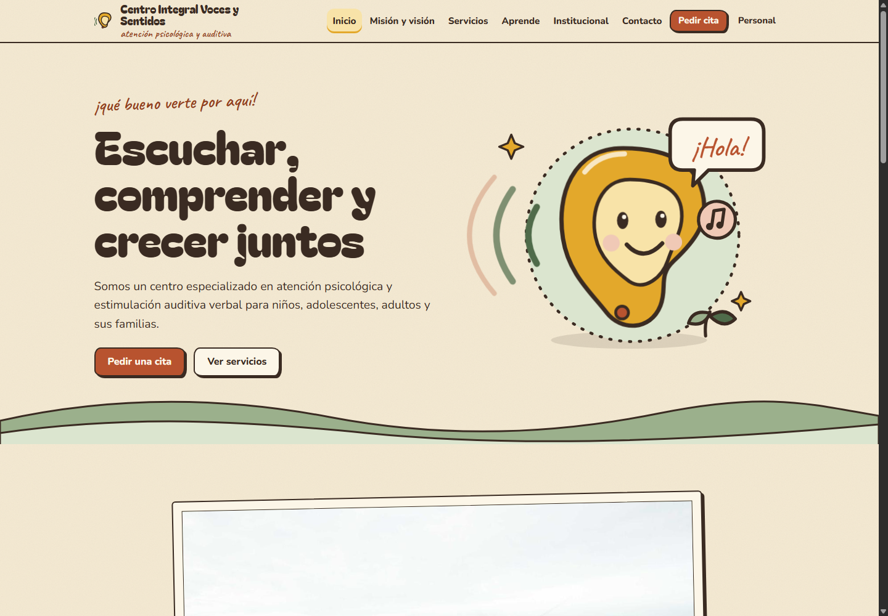
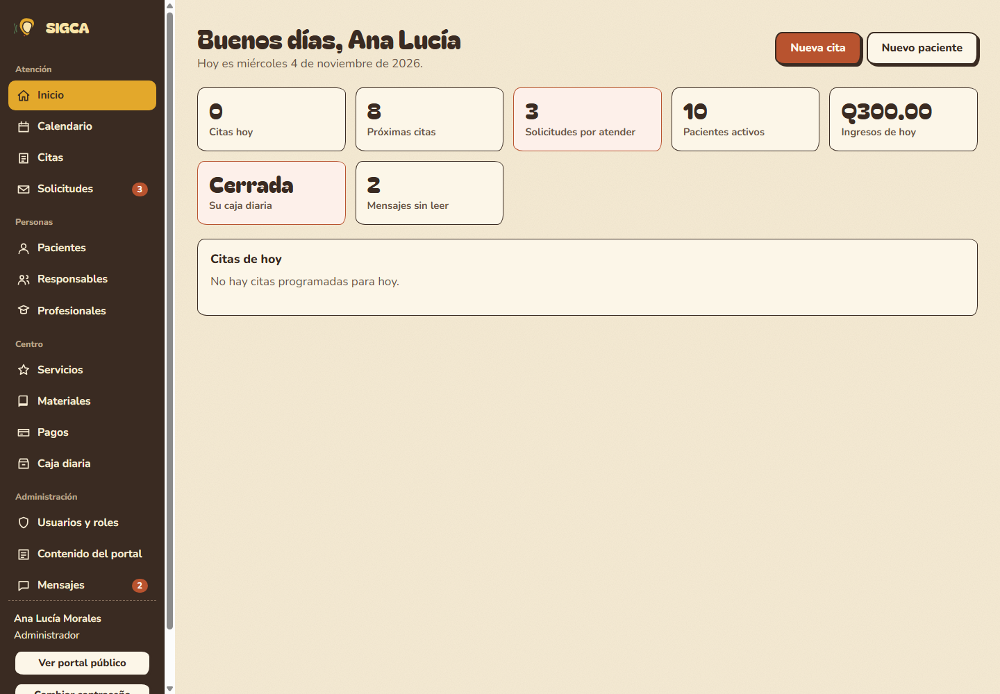
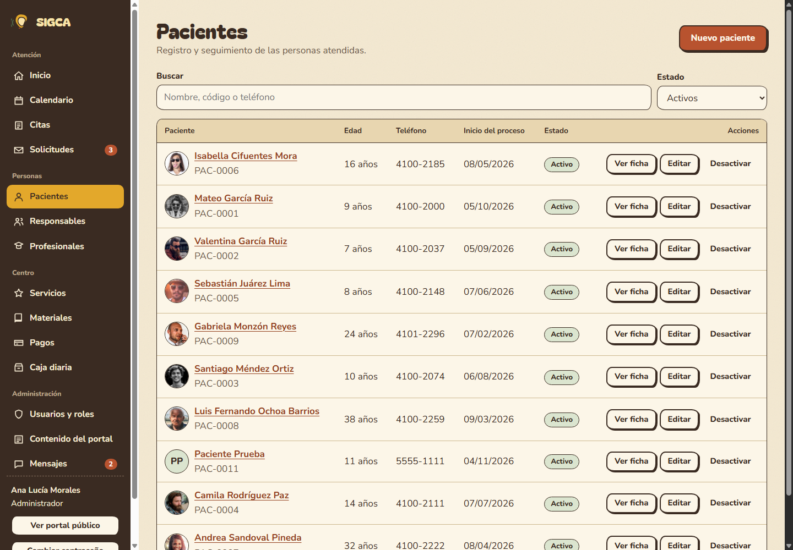
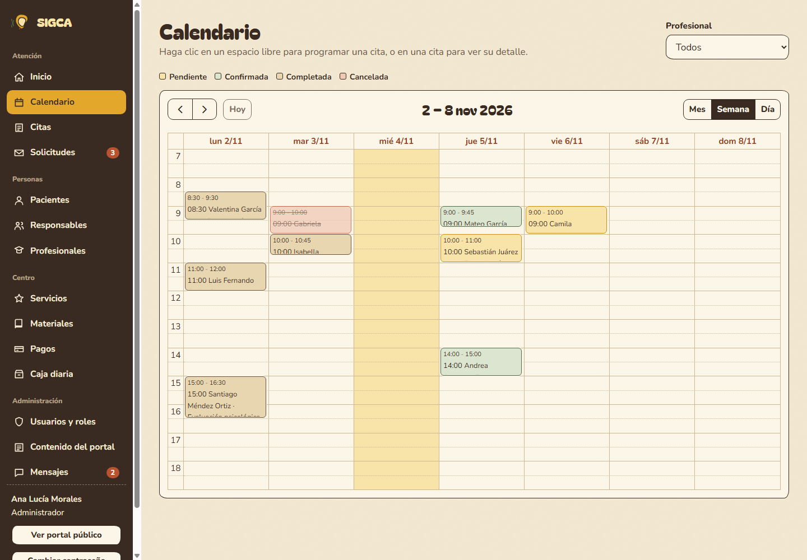
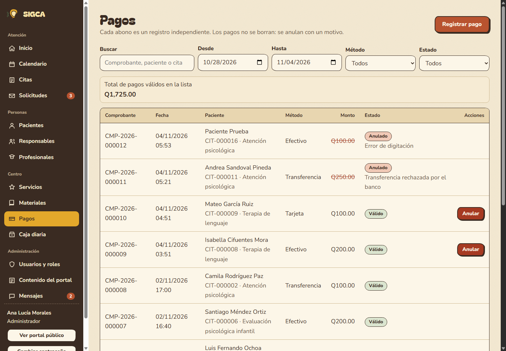
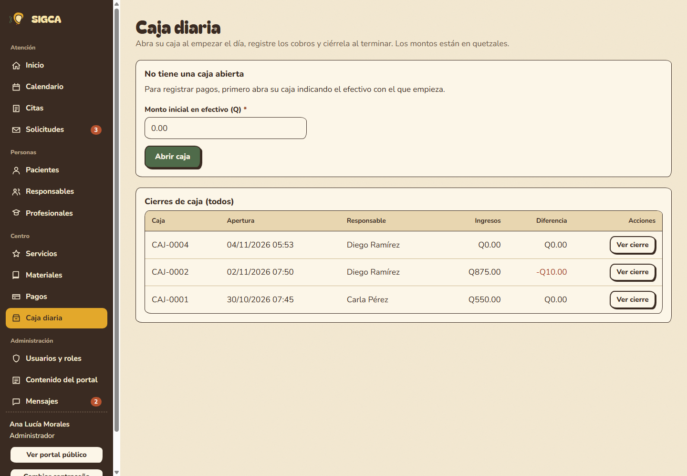

# SIGCA — Sistema Integral de Gestión de Citas y Atención

Aplicación web Full Stack para un centro de atención psicológica y estimulación auditiva verbal. Integra un **portal público** (información institucional, servicios, contenido educativo, horarios, contacto y solicitud de citas) con un **sistema administrativo privado** (pacientes, responsables, profesionales, servicios, citas, calendario, materiales, pagos, saldos y caja diaria).

Proyecto Final Integrador — Desarrollo Web — Universidad Mariano Gálvez de Guatemala.

## Integrantes

| Integrante | Carné | Responsabilidad principal |
|---|---|---|
| Kevin Esquivel | 5190-18-3661 | Backend y base de datos |
| Valery Morales | 6590-22-18013 | Frontend e integración |
| Esdras Pérez | 7690-14-6737 | Seguridad y gestión financiera |

## Tecnologías

**Backend:** Node.js 18+, Express 4, MongoDB + Mongoose 8, JSON Web Tokens, bcryptjs, Helmet, express-rate-limit, express-mongo-sanitize, dotenv.

**Frontend:** Vue 3, Vue Router, Pinia, Axios, FullCalendar, Vite.

## Estructura del repositorio

```
sigca/
├── backend/
│   ├── src/
│   │   ├── config/         Conexión a MongoDB
│   │   ├── models/         Modelos Mongoose (13 colecciones + publicaciones y contadores)
│   │   ├── controllers/    Lógica de cada módulo
│   │   ├── routes/         Endpoints y permisos por rol
│   │   ├── middlewares/    Autenticación JWT, roles y manejo central de errores
│   │   ├── services/       Reglas de negocio de citas y cálculos financieros
│   │   ├── utils/          Dinero en centavos, fechas, validaciones
│   │   ├── app.js          Configuración de Express y seguridad
│   │   └── server.js       Punto de entrada
│   ├── seed/seed.js        Datos de prueba
│   ├── tests/              Prueba automática del procedimiento de evaluación
│   └── .env.example
├── frontend/               Aplicación Vue 3 + Vite (ver frontend/README.md)
├── postman/                Colección de Postman
└── docs/                   Guía de defensa y evidencias
```

## Revisión de seguridad y gestión financiera

Se completaron los faltantes de interfaz y validación:

- **Anular pagos:** la tabla permite anular únicamente pagos registrados asociados a una caja abierta; además, el botón respeta el rol y la propiedad de la caja. El backend sigue siendo la autoridad y exige motivo.
- **Reprogramar citas:** se habilitó el botón para citas pendientes/confirmadas y personal administrativo. El backend verifica que el nuevo profesional exista, esté activo y sea realmente profesional, además de volver a comprobar horario y traslapes.
- **Cierre de caja:** cuando el efectivo contado difiere del esperado, el campo observaciones se marca requerido y se valida antes de enviar. El backend mantiene la validación final.
- **Contraseña propia:** se añadió un modal accesible desde la sesión para cambiarla con la contraseña actual, mínimo de 8 caracteres y confirmación; usa `PATCH /api/auth/password`.
- **Traslape del paciente:** el flujo automatizado intenta una cita superpuesta con otro profesional y verifica que el servidor responda `409` por conflicto del paciente.
- **Configuración JWT:** el servidor y el seed cargan `backend/.env` (que nunca se sube a GitHub); el servidor no arranca si falta una clave JWT de al menos 32 caracteres.
- **Reglas de negocio reforzadas:** un menor de edad necesita al menos un responsable antes de programar citas (RN-04), los materiales solo se asignan a pacientes activos (RN-09) y una cita con pagos válidos no puede cancelarse hasta anularlos (RN-27).
- **Rutas del enunciado:** además de las rutas que usa el frontend, la API expone los nombres exactos de la sección 8 (`/api/auth/me`, `/api/solicitudes-cita`, `/api/contacto`, `/api/citas/:id/pagos`, `/api/citas/:id/saldo` y `/api/cajas/...`, incluidos `/api/cajas/:id/movimientos` y `/api/cajas/:id/cerrar`).

La autenticación JWT, la carga del usuario activo en cada petición, el control de permisos por rol, los estados de citas, la caja del usuario y los importes enteros en centavos ya están protegidos por el backend. El flujo también comprueba tokens inválidos, revocación inmediata al desactivar un usuario y que el profesional no pueda consultar teléfonos de responsables. El frontend no sustituye esas comprobaciones.

### Ejecutar las validaciones

1. Dentro de `backend/`, copie la plantilla (`copy .env.example .env` en Windows o `cp .env.example .env` en Linux/macOS) y en `backend/.env` configure `MONGODB_URI` y `JWT_SECRET` con una clave aleatoria de al menos 32 caracteres.
2. Cargue los datos ficticios con `npm run seed` desde `backend/` (el seed limpia las colecciones de la base configurada).
3. Inicie la API (`npm run dev`) y el frontend (`npm run dev` desde `frontend/`).
4. Con la API activa, ejecute `npm run test:flujo` desde `backend/`. Incluye autenticación, roles, pacientes, citas, traslapes, pagos, caja, cierre y validación del portal.
5. Ejecute `npm run build` desde `frontend/` para validar la compilación de producción.

### Evidencias visuales

Las capturas del portal y módulos administrativos se guardan en [`docs/evidencias/`](docs/evidencias/):

| Vista | Captura |
|---|---|
| Portal público |  |
| Administración |  |
| Pacientes |  |
| Calendario |  |
| Pagos |  |
| Caja diaria |  |

## Requisitos de instalación

> Guía paso a paso para Windows, con solución de problemas frecuentes: [INSTALACION-WINDOWS.md](INSTALACION-WINDOWS.md).

1. **Node.js 18 o superior** (`node -v`).
2. **MongoDB 6 o superior**, de una de estas dos formas:
   - **Local:** instalar MongoDB Community Server (en Windows queda como servicio y escucha en `mongodb://127.0.0.1:27017`). Se recomienda instalar también MongoDB Compass para revisar los datos.
   - **MongoDB Atlas (nube):** crear un clúster gratuito, un usuario de base de datos, permitir su IP en *Network Access* y copiar la cadena de conexión `mongodb+srv://...`.
3. Git.

## Configuración de MongoDB y variables de entorno

Cree `backend/.env` a partir de la plantilla; tanto `npm run dev` como `npm run seed` cargan las variables de ese archivo:

```bash
cd backend
copy .env.example .env      # Windows (en Linux/macOS: cp .env.example .env)
# Edite .env y configure MONGODB_URI y JWT_SECRET.
```

Para generar una clave segura: `node -e "console.log(require('crypto').randomBytes(32).toString('hex'))"`.

| Variable | Descripción | Ejemplo |
|---|---|---|
| `PORT` | Puerto de la API | `4000` |
| `MONGODB_URI` | Conexión a MongoDB (local o Atlas) | `mongodb://127.0.0.1:27017/sigca` |
| `JWT_SECRET` | Clave aleatoria de al menos 32 caracteres para firmar tokens | Genérela y no la comparta |
| `JWT_EXPIRES_IN` | Duración de la sesión | `8h` |
| `CORS_ORIGIN` | URL del frontend | `http://localhost:5173` |
| `TZ_OFFSET` | Zona horaria del centro | `-06:00` |

> `backend/.env` está en `.gitignore` y nunca se sube al repositorio. `backend/.env.example` es solo la plantilla versionada: no coloque en ella credenciales reales.

## Comandos de ejecución

**Backend**

```bash
cd backend
npm install
npm run seed        # carga datos de prueba (BORRA los datos existentes)
npm run dev         # inicia la API en http://localhost:4000/api
```

**Frontend** (en otra terminal)

```bash
cd frontend
npm install
npm run dev         # abre http://localhost:5173 (el proxy envía /api a http://localhost:4000)
```

Más detalle (variables, build, roles y pantallas) en [`frontend/README.md`](frontend/README.md).

**Prueba automática del procedimiento de evaluación** (con la API corriendo y recién cargado el seed):

```bash
cd backend
npm run test:flujo
```

Recorre los pasos de la sección 16 del enunciado (login, paciente, responsable, servicio, cita, traslapes, reprogramación, caja, abonos, saldo, cierre, permisos, etc.) y valida 53 resultados esperados.

### Resultados de validación

Validado el **4 de noviembre de 2026** en una base MongoDB local aislada para la prueba:

- `npm run test:flujo`: **53 correctas, 0 errores** (código de salida 0), incluye los casos de traslape entre citas de un paciente y reprogramación.
- `npm run build` en `frontend/`: compilación de producción correcta.
- `node --check` en los archivos backend modificados: correcto.
- Cambio de contraseña propio: contraseña actual incorrecta rechazada (`400`), cambio correcto (`200`), credencial anterior rechazada (`401`) y nueva credencial aceptada (`200`).
- Modal en navegador: impide confirmar una contraseña distinta y permite guardar la confirmación correcta.
- Arranque del API con clave JWT menor de 32 caracteres: rechazado como se esperaba.
- Docker no está disponible en este entorno; las pruebas API utilizaron el servicio MongoDB local disponible.

**Alcance pendiente:** el flujo automatizado es secuencial y no valida solicitudes simultáneas. Antes de un despliegue con varios usuarios concurrentes, se recomienda añadir y probar protección atómica contra doble reserva, sobrepago concurrente y apertura simultánea de cajas.

## Datos de prueba

`npm run seed` crea: 1 administrador, 2 recepcionistas, 3 profesionales y 1 usuario inactivo; 10 pacientes (6 menores, 1 inactivo); 5 responsables; 5 servicios; 15 citas en todos los estados; 11 pagos (completos, parciales y 2 anulados); 3 cajas (2 cerradas — una con faltante de Q10.00 — y 1 abierta); 5 materiales con asignaciones; 5 solicitudes (pendientes, atendida y rechazada); contenido institucional, publicaciones, horarios y mensajes de contacto. Todos los datos son ficticios.

## Credenciales de demostración

| Rol | Correo | Contraseña |
|---|---|---|
| Administrador | admin@sigca.com | Admin123! |
| Recepcionista (con caja abierta) | recepcion1@sigca.com | Recep123! |
| Recepcionista | recepcion2@sigca.com | Recep123! |
| Profesional — Psicología | psicologa@sigca.com | Prof123! |
| Profesional — Lenguaje | terapeuta@sigca.com | Prof123! |
| Profesional — Auditiva | auditiva@sigca.com | Prof123! |
| Usuario inactivo (no puede ingresar) | inactivo@sigca.com | Inactivo123! |

## Colección de Postman

Importe `postman/SIGCA.postman_collection.json` (81 solicitudes en 10 carpetas, con las rutas de la sección 8 del enunciado). Con la API activa y los datos recién cargados, ejecute la colección completa con *Run collection*, o las carpetas en orden: el token y los IDs creados se guardan solos en variables de la colección. Incluye las pruebas de la sección 16 que no cubre `test:flujo`: segundo pago y estado PAGADO, comprobante, pagos con distintos métodos, ingresos del día, cierre con diferencia, pago con caja cerrada y cancelación bloqueada de una cita con pagos (RN-27). Puede ejecutarse varias veces seguidas sin volver a cargar los datos.

## Seguridad implementada

Contraseñas con bcrypt; autenticación JWT; usuarios inactivos bloqueados aunque tengan token vigente; permisos por rol verificados en cada endpoint del backend; hashes nunca expuestos (`select: false`); lista blanca de campos en cada formulario (evita asignación masiva); saneamiento contra inyección NoSQL; cabeceras Helmet; límite de intentos en login y formularios públicos; manejo centralizado de errores con códigos HTTP adecuados; secretos en variables de entorno.

## Distribución de responsabilidades

| Integrante | Módulos |
|---|---|
| Integrante 1 — Backend y base de datos | Modelos, API REST, pacientes, responsables, servicios |
| Integrante 2 — Frontend e integración | Vue, Router, Pinia, portal público, formularios, calendario |
| Integrante 3 — Seguridad y finanzas | Autenticación, roles, citas, pagos, caja diaria, validaciones |

_(Ajustar según la distribución real del grupo.)_
